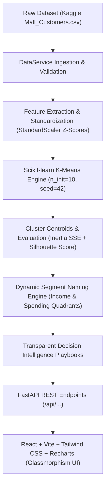

# CustomerLens AI — Customer Segmentation & Intelligent Analytics

> **Portfolio-Grade Full-Stack Machine Learning Web Application**  
> Developed for Artificial Intelligence & Machine Learning (AIML) Academic Project Demonstrations and Enterprise Marketing Analytics.

---

## 🌟 Executive Overview

**CustomerLens AI** is an end-to-end unsupervised machine learning platform that partitions retail customers into actionable behavioral archetypes. Built upon the authentic **Kaggle Mall Customers dataset** (200 records), the platform moves beyond simple statistical clustering by deriving transparent, rule-based marketing playbooks from mathematical cluster centroids.

Featuring a modern **Glassmorphism** design system with a dark midnight-blue palette, purple/cyan ambient lighting, and interactive charts, CustomerLens AI empowers both data scientists and marketing strategists to understand, visualize, and activate customer segments.

---

## 📐 System Architecture



---

## 🚀 Key Modules & Pages

### 1. Overview Dashboard (`/`)
- **Key Performance Indicators (KPIs)**: Total analyzed customers, identified cluster count, global average annual income ($k), average spending score (1-100), and silhouette score.
- **2D Customer Clustering Scatter Plot**: Real-time Recharts visualization with cluster color coding and centroid markers.
- **Segment Distribution Donut Chart**: Proportional breakdown of customer share per segment.
- **Feature Benchmark Bar Chart**: Side-by-side comparison of Average Annual Income vs. Spending Score.
- **Executive Strategic Highlights**: Automated highlights of the highest-value segment and dominant cohort.

### 2. Customer Segmentation Engine (`/segmentation`)
- Real Scikit-learn K-Means model training with interactive controls:
  - Feature selection (`Age`, `Annual Income (k$)`, `Spending Score (1-100)`).
  - Cluster count slider ($K = 2 \dots 10$, default $K = 5$).
  - `StandardScaler` toggle for distance normalization.
- Live inertia calculation and silhouette score validation.
- Centroid coordinates table in original unscaled space.
- Interactive cluster scatter plot with customizable X and Y axes.

### 3. Customer Explorer (`/customers`)
- Searchable and filterable customer table.
- Multi-dimensional filters: Cluster filter, Gender filter, Age range slider, Annual Income range, and Spending Score range.
- Sortable table columns with pagination controls.
- **Customer Intelligence Modal**: Inspect individual customer percentile benchmarks, Euclidean distance to cluster centroid, and personalized marketing advice.
- **CSV Export**: Direct download of filtered or full customer records with cluster assignments and segment labels.

### 4. Segment Profiles (`/profiles`)
- Detailed behavioral cards for each identified cluster.
- **Editable Business Labels**: Inline rename modal allowing users to customize business interpretations (persisted in backend).
- Key distinguishing characteristics ($\pm X\%$ difference vs. global benchmarks).
- Tailored marketing strategies for each segment.

### 5. Strategic Business Insights (`/insights`)
- Transparent rule-based business intelligence playbooks.
- Priority tiers, urgency ratings, prescribed tactical actions, recommended marketing channels, and churn risk factors.
- Demographic age cohort analysis ($<30$ yrs, $30-49$ yrs, $50+$ yrs).
- AI transparency declaration: Explicitly declares deterministic statistical derivation (no synthetic hallucinations).
- Strategy export as a structured JSON report.

### 6. Model Evaluation Lab (`/model-lab`)
- **Elbow Method Curve**: Plots Inertia (WCSS) against $K = 2 \dots 10$.
- **Silhouette Coefficient Curve**: Tracks cluster separation across $K$ values.
- Automated heuristic recommendation for optimal $K$.
- Cluster centroid coordinate matrix.
- Exportable model configuration metadata JSON.

### 7. Dataset Management (`/dataset`)
- Data integrity inspection: File size, row count, null detection, duplicate records.
- Clean sample CSV download (`Mall_Customers.csv`).
- CSV file upload with validation for required columns and numeric formats.
- Parametric summary statistics table (mean, standard deviation, quartiles, median, min/max).
- Raw data preview (first 10 records).
- One-click restoration back to the authentic Kaggle baseline.

### 8. Project Information & Viva Guide (`/about`)
- Academic problem statement, objectives, and limitations of manual analysis.
- End-to-end system architecture breakdown.
- Mathematical deep-dive into K-Means, Inertia, and Silhouette coefficients.
- Comprehensive Academic Viva Q&A Guide featuring 8 high-yield questions and model answers.

---

## 🛠️ Technology Stack

| Layer | Technologies |
|---|---|
| **Frontend** | React 19, TypeScript, Vite, Tailwind CSS v4, Recharts, Lucide React, React Router v7 |
| **Backend** | Python 3.10+, FastAPI, Pandas, NumPy, Scikit-learn, Joblib, Pydantic v2, Uvicorn |
| **Storage & Data** | Kaggle Mall Customers CSV, Joblib Model Serialization, JSON Metadata |
| **Testing** | Pytest, FastAPI TestClient |

---

## 📂 Project Directory Structure

```text
ML - project/
├── backend/
│   ├── app/
│   │   ├── main.py              # FastAPI application entry point & lifespan
│   │   ├── config.py            # Paths, default features, Kaggle metadata
│   │   ├── dependencies.py      # Shared service singletons
│   │   ├── schemas/             # Pydantic v2 schemas
│   │   │   ├── customer.py
│   │   │   └── model.py
│   │   ├── services/            # Business & ML logic
│   │   │   ├── data_service.py  # Data loading, validation, filtering, CSV export
│   │   │   ├── ml_service.py    # K-Means, StandardScaler, Elbow, Silhouette
│   │   │   └── insight_service.py # Rule-based strategic marketing playbooks
│   │   └── routes/              # Modular API endpoints
│   │       ├── health.py
│   │       ├── dataset.py
│   │       ├── clustering.py
│   │       ├── customers.py
│   │       └── insights.py
│   ├── data/
│   │   ├── Mall_Customers.csv   # Authentic Kaggle dataset (200 records)
│   │   ├── current_dataset.csv  # Active working dataset
│   │   ├── fitted_kmeans.joblib # Serialized Scikit-learn model
│   │   └── model_metadata.json  # Fitted parameters & custom segment names
│   ├── tests/
│   │   ├── test_data_processing.py
│   │   ├── test_clustering.py
│   │   └── test_api.py
│   └── requirements.txt
├── frontend/
│   ├── src/
│   │   ├── components/          # Reusable Glassmorphism UI & Recharts components
│   │   ├── pages/               # 8 full-featured application pages
│   │   ├── services/api.ts      # Typed REST API service layer
│   │   ├── types/index.ts       # TypeScript interfaces
│   │   ├── index.css            # Glassmorphism tokens, backdrop blur, ambient glow
│   │   ├── App.tsx              # Application layout & routing
│   │   └── main.tsx
│   ├── package.json
│   ├── vite.config.ts           # Vite + Tailwind v4 + Proxy (/api -> :8000)
│   └── tsconfig.app.json
├── pytest.ini
└── README.md
```

---

## ⚡ Quickstart Guide (PowerShell / Windows)

### Prerequisites
- Python 3.10 or higher
- Node.js 18 or higher (Node v20+ recommended)

### 1. Backend Setup & Startup

Open a PowerShell terminal and run:

```powershell
cd "c:\Users\pursh\OneDrive\Desktop\ML - project"

# Install backend Python dependencies
pip install -r backend/requirements.txt

# Run test suite to verify data processing & ML clustering
python -c "import sys; sys.path.insert(0, 'backend'); import pytest; sys.exit(pytest.main(['backend/tests', '-p', 'no:pytest_ethereum', '-v']))"

# Start FastAPI backend server
cd backend
python -m uvicorn app.main:app --host 127.0.0.1 --port 8000 --reload
```

The backend API will be available at `http://127.0.0.1:8000`.  
Swagger UI documentation: `http://127.0.0.1:8000/docs`.

### 2. Frontend Setup & Startup

Open a second PowerShell terminal:

```powershell
cd "c:\Users\pursh\OneDrive\Desktop\ML - project\frontend"

# Install frontend dependencies (if not already installed)
npm install

# Start Vite development server
npm run dev
```

Open your browser and navigate to:  
👉 **`http://127.0.0.1:5173/`**

---

## 📊 Dataset Information

- **Dataset Name**: Mall Customers Dataset
- **Kaggle Source**: [Customer Segmentation Tutorial in Python](https://www.kaggle.com/datasets/vjchoudhary7/customer-segmentation-tutorial-in-python)
- **Local File Path**: `backend/data/Mall_Customers.csv`
- **Instance Count**: 200 customers
- **Attributes**:
  1. `CustomerID`: Unique sequential integer identifier (kept as ID, excluded from clustering).
  2. `Gender`: Categorical (`Male`, `Female`).
  3. `Age`: Integer customer age (18 to 70 years, $\mu \approx 38.85$).
  4. `Annual Income (k$)`: Annual income in thousands of dollars (15 to 137 $k$, $\mu \approx 60.56$).
  5. `Spending Score (1-100)`: Behavioral score assigned based on purchase history and activity (1 to 99, $\mu \approx 50.20$).

---

## 🎓 Academic Viva Voce Explanation Guide

| Topic | Examination Question | High-Scoring Academic Answer |
|---|---|---|
| **Paradigm** | Why is this an unsupervised machine learning task? | Customer segmentation has no ground-truth target labels ($y$). The objective is to discover latent geometric partitions based on feature similarity without prior supervision. |
| **Scaling** | Why must `StandardScaler` be applied before K-Means? | K-Means computes Euclidean distances ($d(x, \mu) = \sqrt{\sum (x_i - \mu_i)^2}$). Because Annual Income has a much higher scale and variance than Spending Score, unscaled clustering would be biased toward Income. `StandardScaler` computes $z = \frac{x - \mu}{\sigma}$ so both features contribute equally. |
| **Optimization** | What is Lloyd's algorithm and how does it guarantee convergence? | Lloyd's algorithm alternates between the **Assignment Step** (assigning points to nearest centroids) and the **Update Step** (recomputing centroids as cluster means). Because the cost function (WCSS) decreases monotonically with each iteration and there are a finite number of partitions, it is guaranteed to converge to a local minimum. |
| **Model Selection** | How do the Elbow Method and Silhouette Score differ? | **Inertia (Elbow Method)** measures internal cluster compactness ($WCSS$). **Silhouette Score** ($s = \frac{b - a}{\max(a, b)}$) evaluates both intra-cluster compactness ($a$) and inter-cluster separation ($b$). While Inertia always decreases as $K$ increases, Silhouette Score peaks at the most well-separated clustering ($K=5$ yields $\approx 0.55$). |
| **Business Value** | How are cluster IDs translated into business strategies? | K-Means produces only mathematical integers ($0, 1, 2, ...$). CustomerLens AI inspects centroid averages relative to the population mean. Clusters with high income and high spending trigger VIP retention tactics, while high income and low spending trigger luxury activation campaigns. |

---

## 📄 License & Attribution

- Built as an open-source Artificial Intelligence & Machine Learning portfolio project.
- Dataset provided by [Vijay Choudhary on Kaggle](https://www.kaggle.com/datasets/vjchoudhary7/customer-segmentation-tutorial-in-python).
